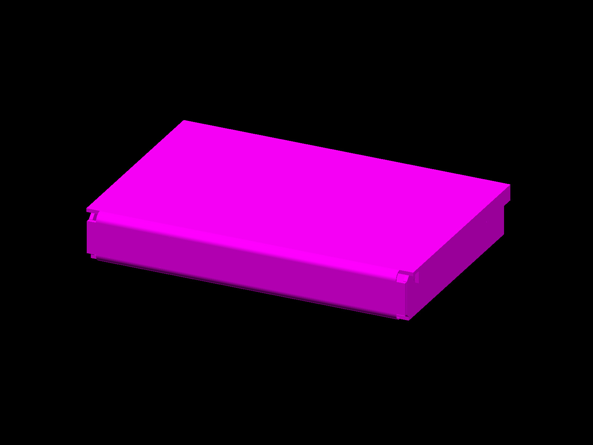
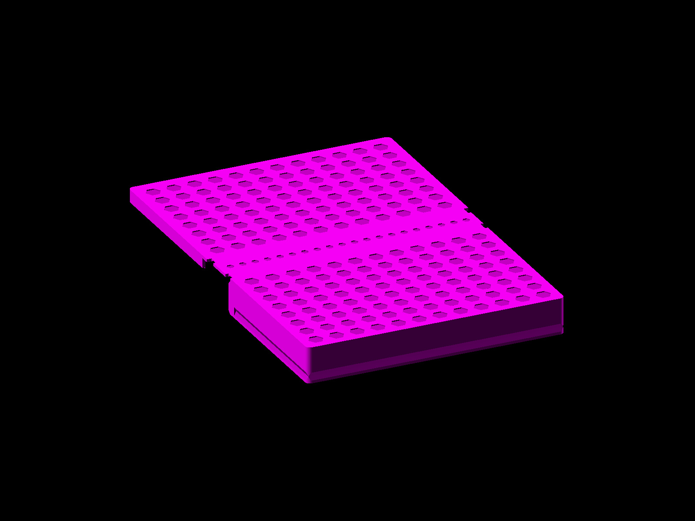
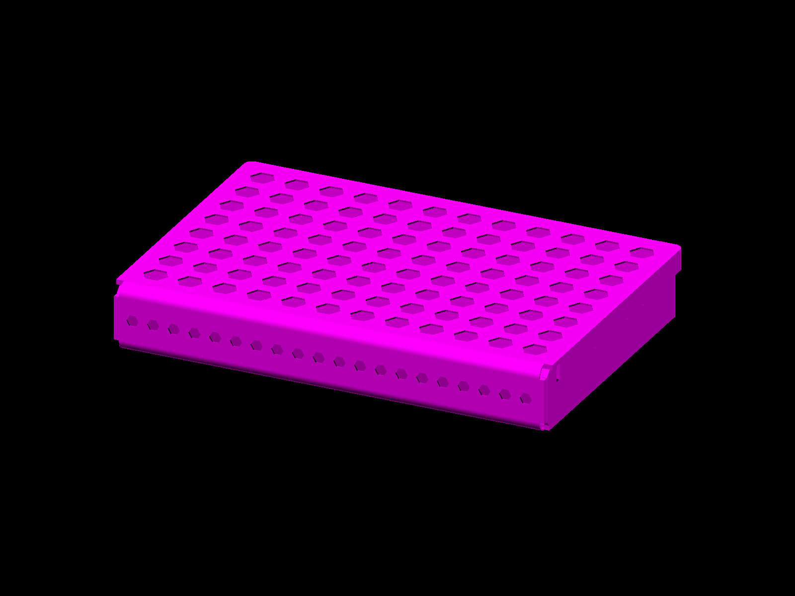

# cassette box

a one-piece cassette clamshell with two thin hinges, a rectangular hub lock,
and optional lettering and face patterns.

- [OpenSCAD source](cassette-box.scad)
- [print-flat STL](cassette-box.stl) / [closed STL](cassette-box-closed.stl)
- [example print-flat STL](cassette-box-example.stl) / [example closed STL](cassette-box-example-closed.stl)
- [hexagon example print-flat STL](cassette-box-hexagon-example.stl)

run `make` to rebuild all eleven files. the default OpenSCAD path is the installed
macOS app; ImageMagick must be on PATH.
if needed, use `make OPENSCAD=/path/to/OpenSCAD`. separate lettering and hexagon
examples live in the [Makefile](Makefile).

font sizes are `front_text_size`, `back_text_size`, and `spine_text_size` in the
Customizer. change `text_font` to an installed font from OpenSCAD's font list.
each face has engraved, raised, through, and off modes, position offsets,
and 90-degree rotations.
set `spine_text_right` for a right-aligned year and a left-aligned main label.

for patterns, choose `front_texture_shape`, `back_texture_shape`, or
`spine_texture_shape`: off (default), circle, square, or hexagon. each face has
its own `*_texture_size` (maximum shape width) and `*_texture_mode`:
engraved (inset), raised, or through (puncture the panel).
`texture_gap` is the minimum spacing; whole shapes are arranged in centered,
evenly spaced rows and columns. `texture_margin` sets a minimum border,
increased on the front/back to clear walls and rounded corners. if a shape
cannot fit, reduce its size or the border.

`text_relief` and `texture_relief` control recess depth or raised height;
engraving must leave at least 0.4 mm of panel. through mode ignores relief
and cuts the full panel thickness. back through-cuts preserve the hub-lock
attachment: overlapping pattern shapes are omitted, and lettering is clipped
around it. patterns and lettering share the face, so check any overlap.
through-cuts let dust in; enclosed letter centers (such as O) can become loose
pieces, so use a stencil font for through lettering.

print the flat version with a 0.4 mm nozzle and 0.2 mm layers. closed files are
for inspection. raised lettering or texture needs a different bed/support setup.
PLA hinges are experimental; test gently. hub-lock dimensions need a fit check.
