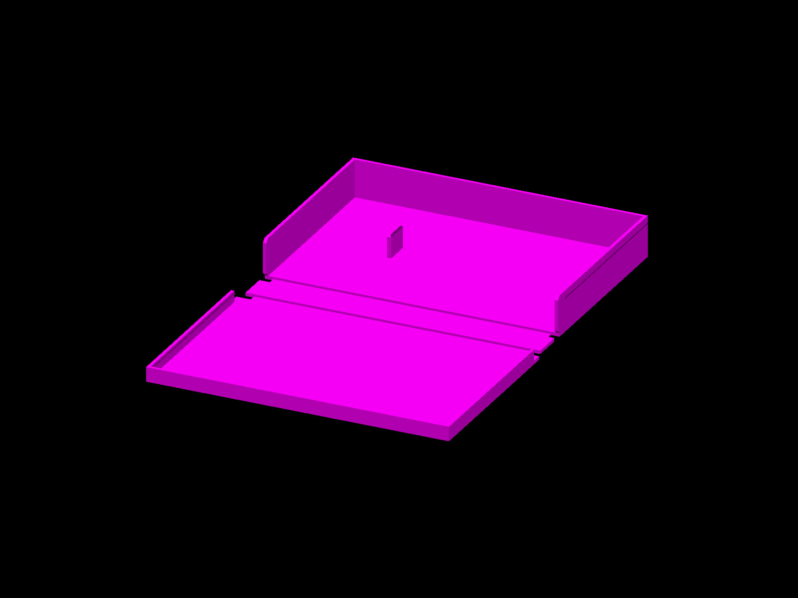

# cassette box

a one-piece cassette clamshell with two thin hinges, a rectangular hub lock,
and an optional full-width finger tab.

- [OpenSCAD source](cassette-box.scad)
- [print-flat STL](cassette-box.stl) / [closed STL](cassette-box-closed.stl)
- [example print-flat STL](cassette-box-example.stl) / [example closed STL](cassette-box-example-closed.stl)

run `make` with OpenSCAD and ImageMagick on PATH to rebuild all eight files.
if needed, use `make OPENSCAD=/path/to/OpenSCAD`. example labels live in the
[Makefile](Makefile).

font sizes are `front_text_size`, `back_text_size`, and `spine_text_size` in the
Customizer. change `text_font` to an installed font from OpenSCAD's font list.
each face has engraved/raised modes, position offsets, and 90-degree rotations.
set `spine_text_right` for a right-aligned year and a left-aligned main label.

print the flat version with a 0.4 mm nozzle and 0.2 mm layers. closed files are
for inspection. raised lettering needs a different bed/support setup.
PLA hinges are experimental; test gently. hub-lock dimensions need a fit check.
